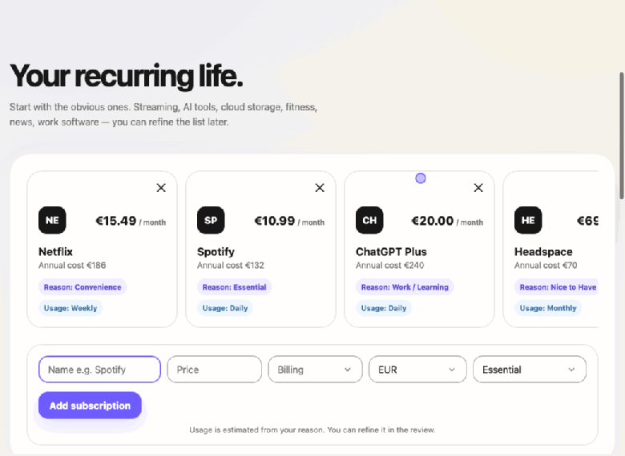
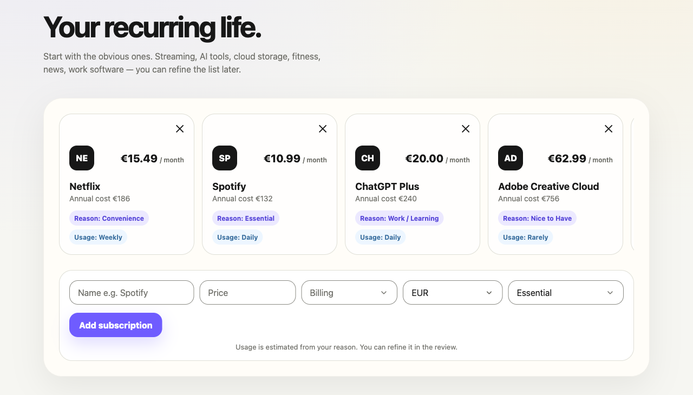
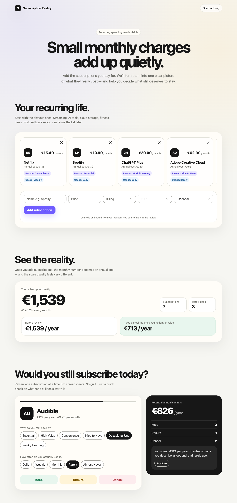
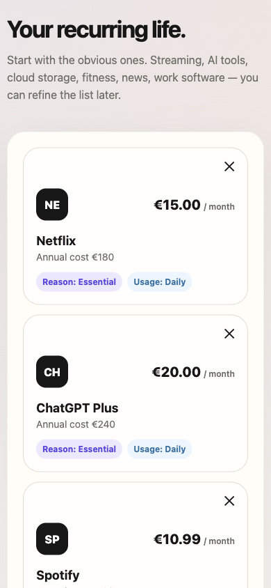
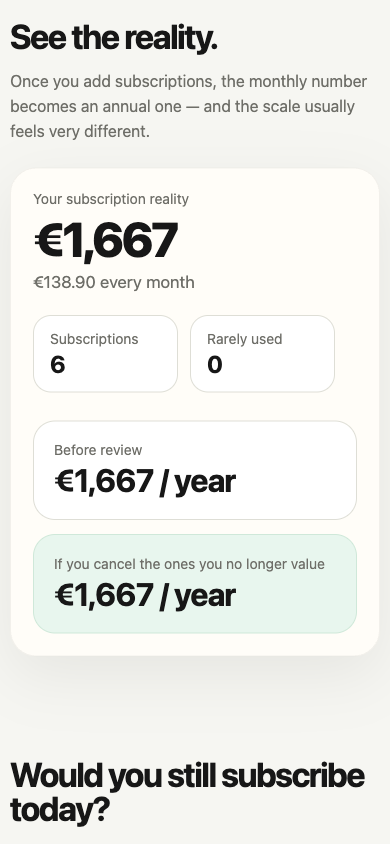

# Subscription Reality

[](https://github.com/A-Selim/subscription-reality/actions/workflows/ci.yml) [](https://github.com/A-Selim/subscription-reality/actions/workflows/deploy-pages.yml) [](LICENSE) [](https://angular.dev)

**Small monthly payments feel cheap. Annual recurring spending often tells a different story.**

A small, privacy-first web app that shows what your subscriptions really cost per year and helps you decide which ones are still worth keeping. No account, no backend, no bank connection: your data never leaves the browser.

**Live demo: [a-selim.github.io/subscription-reality](https://a-selim.github.io/subscription-reality/)**

Built with **Angular 22** (standalone components, signals, Signal Forms, zoneless), **TypeScript (strict)** and **IndexedDB**, with 248 tests and a WCAG AA target.



## The problem

People pay for many small subscriptions. Each one feels cheap on its own, so they rarely see the whole picture: what they pay per year, and which subscriptions they no longer use. Finance dashboards feel heavy, and bank-connected tools ask for a lot of trust. This app turns the list into one clear yearly number, then walks through it one subscription at a time.

## Features

- **Quick add:** name, price, monthly or yearly billing, currency (EUR, USD, GBP, EGP) and a reason. Usage frequency is estimated from the reason, and the last currency used is remembered.
- **See the reality:** one card per currency with the yearly total up front, the monthly total and a before/after comparison. Currencies are never mixed or converted.
- **Review one at a time:** confirm why you have each subscription and how often you use it, then choose **Keep**, **Unsure** or **Cancel**.
- **Potential savings:** subscriptions marked Cancel add up to an annual savings figure per currency. A rule-based insight names subscriptions you describe as optional and rarely use.
- **Edit and delete in place:** deleting asks whether you've actually cancelled with the provider, because removing a subscription from the app doesn't stop the payment.
- **Persistent and accessible:** data is saved in IndexedDB and survives refreshes and restarts. The UI targets WCAG AA and passes axe checks.





On a phone:

<p> </p>

## Limits

- Data lives only in this browser on this device. There is no account and no sync between devices.
- Clearing site data in the browser deletes your subscriptions. There is no export or import yet.
- Currencies are never converted, so each currency has its own totals.
- Other projects on the same `a-selim.github.io` address [share browser storage with this app](docs/deployment.md#keep-one-origin).

## Engineering highlights

- **Pure domain layer.** Costs, usage estimates, the review queue, savings and insights are plain TypeScript functions in `domain/subscription.ts`, with no Angular imports. They are tested directly and reused by every component.
- **Signals end to end.** One `SubscriptionsState` service owns the state in signals. Components derive what they show with `computed()`, and the app runs zoneless with OnPush by default.
- **Ports and adapters for storage.** Components never touch IndexedDB. They go through an `AppStorage` port: IndexedDB in the app, an in-memory fake in tests. Saves run one at a time, so an older save can never overwrite a newer one.
- **Careful with stored data.** Stored data is validated field by field on load with the same rules the forms use. If it can't be read, the app copies it to a separate safety key in IndexedDB and a calm notice tells the user. If storage fails, the app keeps working for the visit and says so.
- **Accessibility by design.** Every control has a real label. Focus moves on purpose: to the totals after the first add, and back to the card after a dialog closes. Native `<dialog>` traps focus, and status changes are announced through live regions.
- **Security.** User text is only rendered through Angular's escaping bindings. The production build ships a hash-based Content-Security-Policy (`security.autoCsp`). The static host sends no extra security headers; see [hosting and headers](docs/deployment.md).
- **Small and fast.** No runtime dependencies beyond Angular. The initial bundle is about 75 kB compressed.

## Testing

```bash
npm test -- --watch=false
```

- **248 tests** with Vitest and jsdom, through `@angular/build:unit-test`.
- Most tests render the whole page and use it as a user would: they find regions, buttons and fields by their accessible names, so a broken label fails a test. A shared helper renders the app on the in-memory storage, and rendering it again on the same storage simulates a reload.
- The domain rules and the load-time validation have their own unit tests.
- Accessibility is checked by hand with axe on each key state (empty, several currencies, review in progress, dialog open, storage notice).

## How it was built

This project was built with an AI-assisted workflow. I acted as the product owner and made every product decision. AI agents did the planning support, the implementation and the review, under written rules.

1. **Brief and decisions.** I wrote the [product brief](docs/project-brief.md) and made a [visual prototype](docs/prototype/index.html) with AI. Decisions made after the brief are recorded in [`docs/agreed-changes.md`](docs/agreed-changes.md), and the domain words in [`CONTEXT.md`](CONTEXT.md). Decisions that are hard to undo are recorded as ADRs, such as [hosting on GitHub Pages](docs/adr/0002-host-on-github-pages.md).
2. **Plan.** Claude Code turned them into a [spec with user stories](.scratch/mvp/spec.md) and small tickets in [`.scratch/mvp/issues/`](.scratch/mvp/issues/), each with acceptance criteria and an agreed test seam. There are 53 so far: 50 for the first version, then follow-ups after launch such as the move to GitHub Pages.
3. **Build.** OpenAI Codex implemented one ticket at a time, test first, following the rules in [`AGENTS.md`](AGENTS.md).
4. **Review.** Claude Code re-ran the tests and the build, checked each change against the coding rules and against its ticket, and checked layout, keyboard use and axe results in a real browser before committing.

## Tech stack

| Area      | Choice                                                             |
| --------- | ------------------------------------------------------------------ |
| Framework | Angular 22: standalone components, signals, Signal Forms, zoneless |
| Language  | TypeScript (strict)                                                |
| Styling   | SCSS                                                               |
| Storage   | IndexedDB, behind an `AppStorage` port                             |
| Tests     | Vitest + jsdom via `@angular/build:unit-test`                      |
| Tooling   | Angular CLI, Prettier                                              |

## Getting started

Requires Node.js `^22.22.3`, `^24.15.0` or `>=26`.

```bash
npm install
npm start                  # dev server at http://localhost:4200
npm test -- --watch=false  # run the test suite once
npm run build              # production build to dist/subscription-reality/browser
```

## Architecture

The app is a **single scrolling page** with no router ([ADR 0001](docs/adr/0001-single-page-no-routing.md)): top bar → hero → your recurring life → see the reality → review and savings. Each section is its own component.

```
src/app/
├── domain/        # Pure business rules: costs, estimated usage, review queue, savings, insights
├── state/         # SubscriptionsState (signals), AppStorage port, IndexedDB adapter, load-time validation
├── shared/        # Form schema and field directive shared by the add and edit forms
├── <section>/     # One folder per page section (hero, recurring-life, reality, review, savings, …)
└── testing/       # In-memory storage and render helpers for tests
```

## Documentation

| File                                                     | Purpose                                                 |
| -------------------------------------------------------- | ------------------------------------------------------- |
| [`docs/project-brief.md`](docs/project-brief.md)         | The original product brief                              |
| [`docs/agreed-changes.md`](docs/agreed-changes.md)       | Decisions made after the brief; these take precedence   |
| [`CONTEXT.md`](CONTEXT.md)                               | Domain glossary (Review decision, Potential savings, …) |
| [`docs/adr/`](docs/adr/)                                 | Architecture decision records                           |
| [`docs/deployment.md`](docs/deployment.md)               | Hosting on GitHub Pages, link previews, caching         |
| [`docs/research/`](docs/research/)                       | Background research (browser storage)                   |
| [`docs/prototype/index.html`](docs/prototype/index.html) | Visual reference prototype                              |
| [`AGENTS.md`](AGENTS.md)                                 | Rules the AI agents follow in this repo                 |
| [`.scratch/mvp/`](.scratch/mvp/)                         | Spec and the resolved tickets                           |

## Credits

- **OpenAI Codex**: wrote the implementation, one ticket at a time, test first.
- **Claude Code** (Anthropic): planning support, tickets, and review of every change.

Product decisions, the brief and the final call on every change: Ahmed Selim. See [How it was built](#how-it-was-built).

## License

[MIT](LICENSE) © 2026 Ahmed Selim
